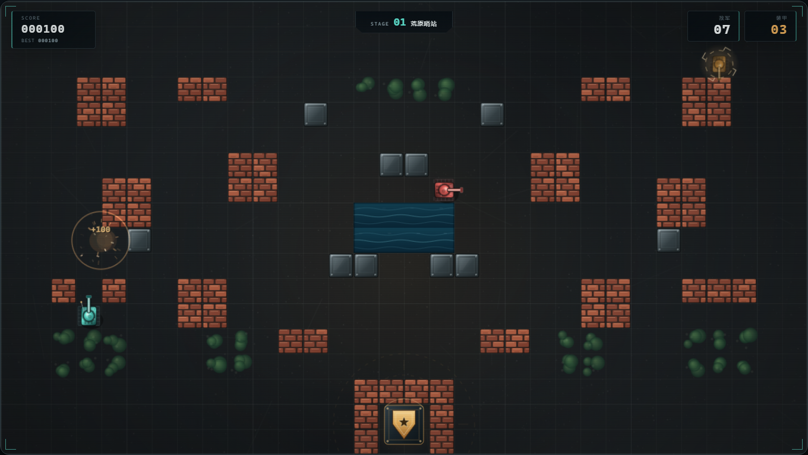

# 钢铁防线 · TANK BATTLE

一款使用 **纯 HTML5 Canvas** 打造的复古坦克防守游戏。没有框架、没有构建步骤、没有外部图片或音频资源，打开浏览器就能玩。

驾驶最后的守卫坦克穿过废墟与火线，在三个战区中击退敌军装甲纵队。砖墙会被炮火撕开，钢板会弹开炮弹，树冠可以遮蔽视野——但基地只有一个，它倒下，任务就结束了。

<p align="center">
  
</p>

## 游戏特色

- **三关战役**：荒原哨站 → 钢铁工厂 → 最终防线，难度与地图逐步升级。
- **可破坏战场**：砖墙可逐格击毁，钢板不可摧毁，水域阻挡履带，树林遮蔽视线。
- **有战术的敌军 AI**：网格 A* 寻路、分兵突袭 / 猎杀玩家、自动轰击基地与挡路砖墙。
- **三种敌方装甲**：侦察车（高速）、炮手（均衡）、重装车（高血量、双弹容量）。
- **四种战场补给**：能量护盾、高速装填、备用装甲、轨道轰击。
- **完整战斗反馈**：粒子爆炸、履带滚动、后坐闪光、屏幕震动、基地脉冲与合成音效。
- **全端适配**：桌面键盘操作；手机横屏自动显示虚拟方向键与开火按钮。
- **本地记录**：最高分与静音设置保存在浏览器 `localStorage` 中。

## 立即开玩

直接双击 `index.html` 即可。也可以启动一个本地静态服务器：

```bash
# 在项目根目录执行
python -m http.server 8000
```

然后访问 <http://localhost:8000>。

> 游戏不需要安装依赖，也不需要编译。推荐使用最新版 Chrome、Edge、Firefox 或 Safari。

## 操作方式

| 操作 | 键盘 | 触屏（横屏） |
| --- | --- | --- |
| 移动 | `W` `A` `S` `D` / 方向键 | 左下方向盘 |
| 开火 | `Space` / `J` | 右下 `FIRE` |
| 暂停 | `P` / `Esc` | 切出页面会自动暂停 |
| 静音 | `M` | 使用设备音量键 |

### 生存守则

1. **基地优先**。敌人会绕过障碍直奔基地，必要时用身体和炮火封住它们的路线。
2. **砖墙不是永久掩体**。它们能拖延敌军，也会被敌军一发发打穿。
3. **吃补给**。护盾可以直接抵消伤害，速射能让你在近身战里压制重装车。
4. **别停在一个射击线上**。敌方炮手一旦与你对齐就会停车开火。

## 项目结构

```text
.
├── index.html      # 页面结构与游戏 HUD
├── style.css       # 界面、响应式布局与动效
├── game.js         # 游戏逻辑、AI、渲染与音效
├── favicon.svg     # 站点图标
├── docs/           # README 截图
└── README.md
```

## 技术实现

- 原生 JavaScript + Canvas 2D，无第三方运行时依赖。
- 1280 × 720 逻辑分辨率，按设备像素比自适应缩放。
- 固定网格地图与连续坐标碰撞结合，支持坦克贴墙滑动与转向对齐。
- 基于权重网格的 A* 寻路，砖墙视为高代价可通行区域。
- 使用 Web Audio API 实时合成射击、爆炸与补给音效。
- 单文件游戏循环 + 离线渲染地面纹理，保持画面细节和运行性能。

## 开发

修改 `game.js` 顶部的 `LEVELS`、`ENEMY_TYPES` 可以调整关卡布局、敌人波次和数值。所有贴图均由 Canvas 绘制，音效均由 Web Audio 合成，因此无需管理素材文件。

---

如果这个游戏让你想起了当年的坦克大战，欢迎点一个 Star。
